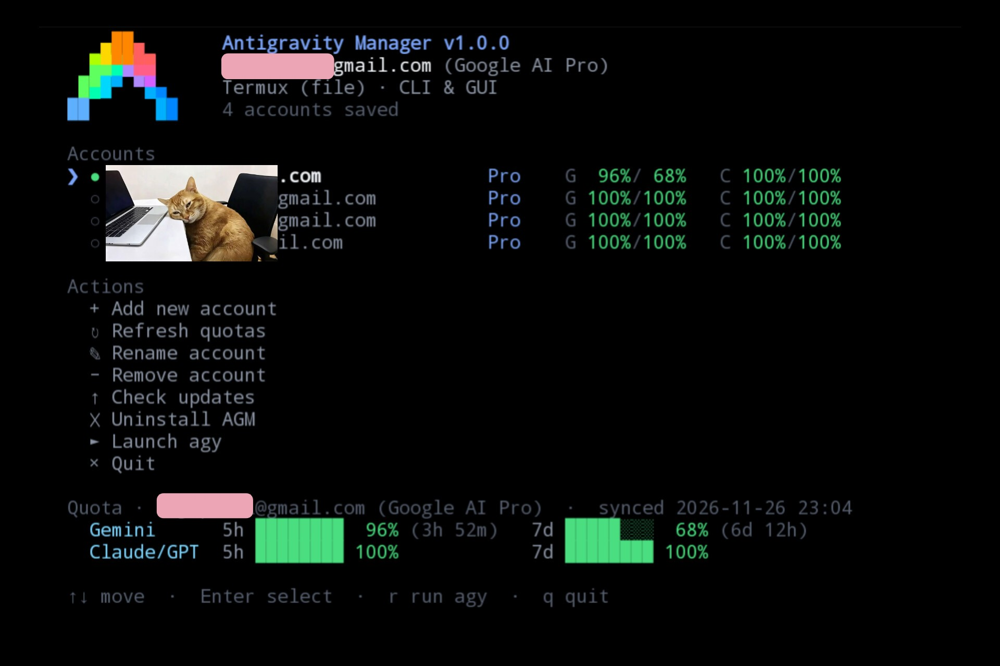

# AGM


Fast, lightweight account switcher & quota viewer for **Antigravity (`agy` CLI & GUI)** on **Linux** and **Termux**.



## Install

**🐧 Linux**
```bash
git clone https://github.com/sajadrahimi-dev/agm.git ~/.agm && ~/.agm/install.sh
```

**📱 Termux**

1. Install dependencies (if not installed):
```bash
pkg install -y git python
```

2. Clone & run:
```bash
git clone https://github.com/sajadrahimi-dev/agm.git ~/.agm && ~/.agm/install.sh
```

## Usage

```bash
agm                 # Interactive menu
agm gui             # Desktop GUI
agm login           # Add & auto-save new account
agm use <name>      # Switch account (CLI & GUI)
agm quota --all     # Refresh quotas & plans
agm update          # Update AGM from GitHub
```

## Uninstall

```bash
~/.agm/uninstall.sh
```
